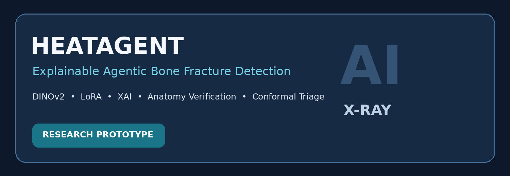
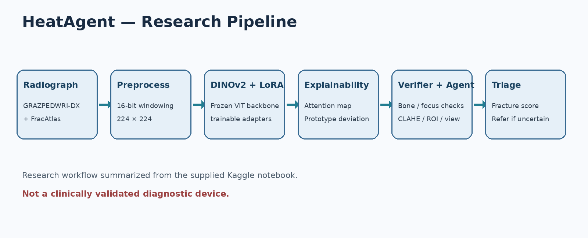
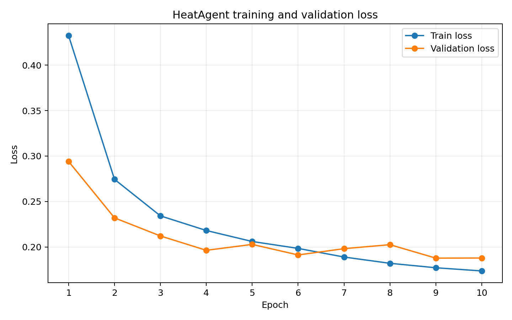
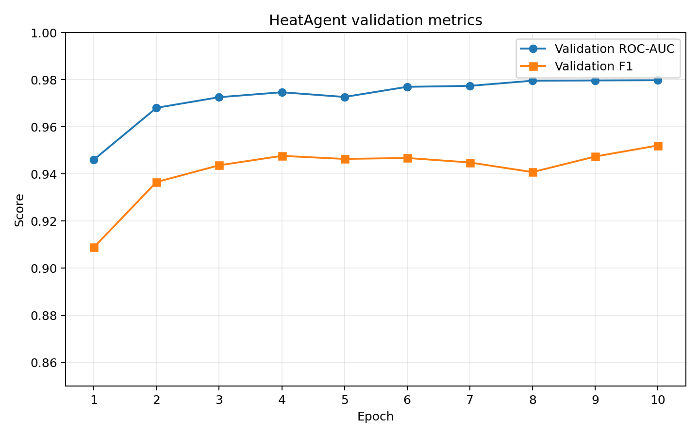
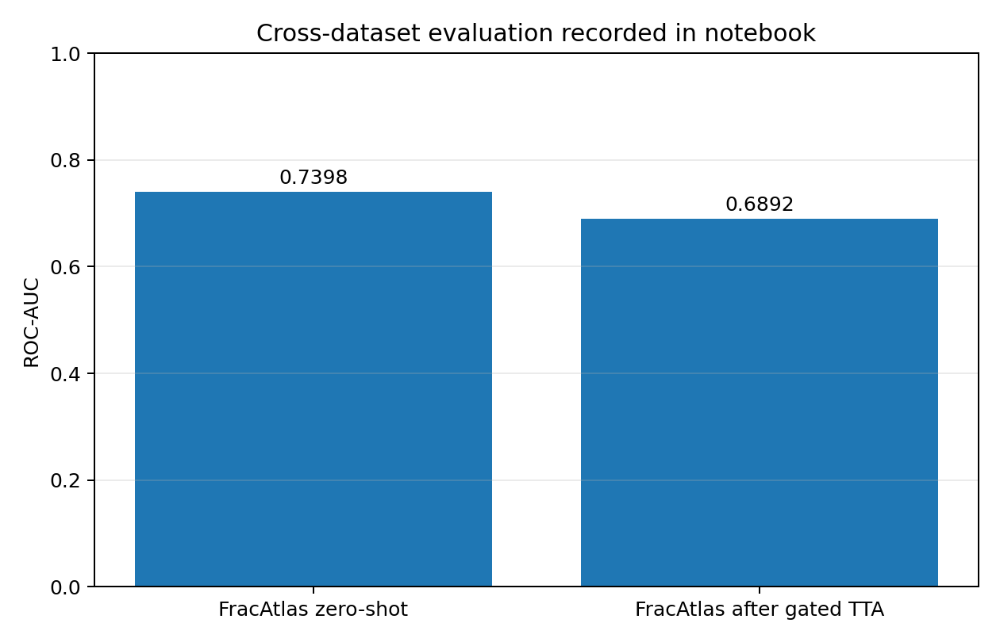
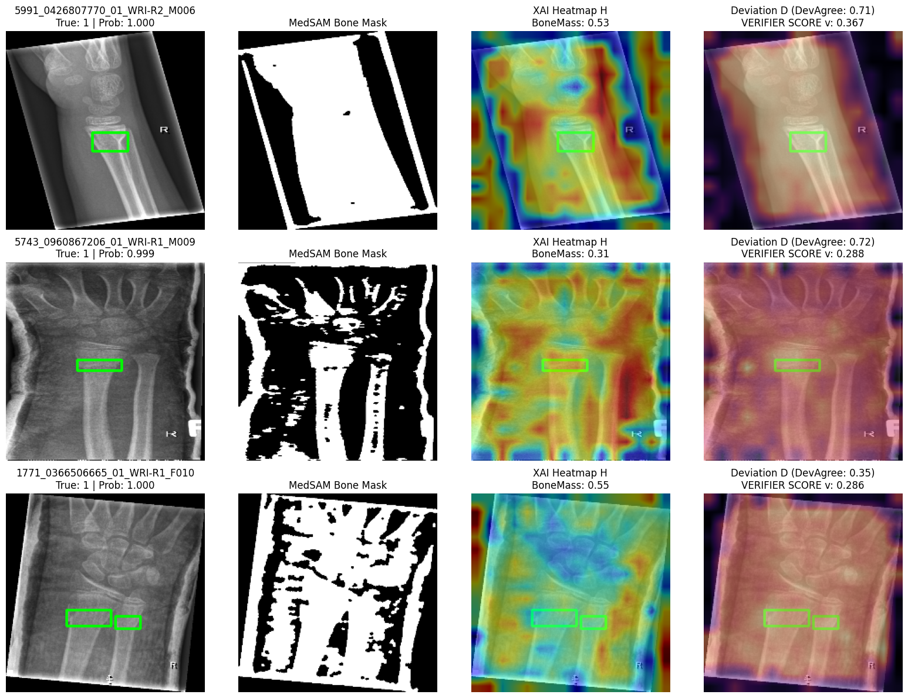
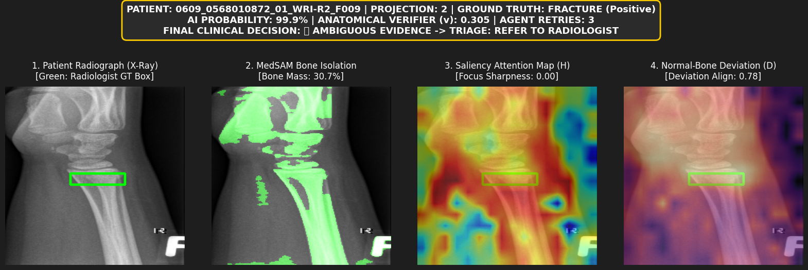
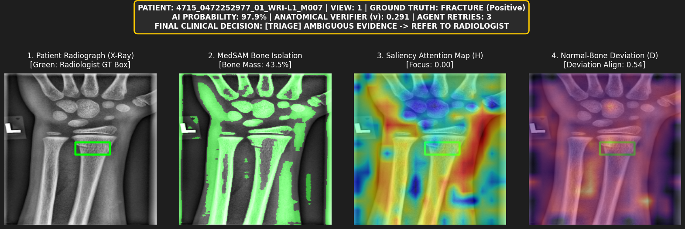

# HeatAgent — Explainable Agentic Bone Fracture Detection





**HeatAgent** is a research prototype for binary bone-fracture classification from radiographs. The supplied Kaggle notebook combines a DINOv2 Vision Transformer with native PyTorch LoRA adapters, visual explanation maps, a heuristic anatomy verifier, and an agent-style retry workflow.

> **Medical disclaimer:** This project is for education and research only. It is not a medical device, has not been clinically validated, and must not be used to diagnose, rule out, or treat a fracture. A qualified radiologist must interpret medical images.

## Project highlights

- **Backbone:** `vit_base_patch14_reg4_dinov2.lvd142m` via `timm`.
- **Parameter-efficient tuning:** LoRA adapters inserted into ViT attention `qkv` projections; the pretrained backbone is frozen.
- **Datasets:** GRAZPEDWRI-DX and FracAtlas.
- **Preprocessing:** percentile-based conversion of 16-bit radiographs to 8-bit, resizing, ImageNet normalization, and training augmentation.
- **Explainability:** patch activation heatmaps and deviation maps against a bank of normal-bone patch prototypes.
- **Verifier / agent workflow:** heuristic bone-mask, focus and prototype-agreement checks; CLAHE and bone-ROI retry tools; the original notebook also implements paired-view inspection.
- **Evaluation experiments:** cross-dataset FracAtlas evaluation, verifier-gated test-time adaptation (TTA), and explanation-aware conformal triage.

## Recorded results from the uploaded notebook

These numbers are taken from the executed outputs embedded in the provided notebook. They are not a guarantee of generalization.

| Experiment | Recorded result |
|---|---:|
| Best GRAZ validation ROC-AUC (10 epochs) | **0.9798** |
| Validation F1 at epoch 10 | 0.9521 |
| FracAtlas zero-shot ROC-AUC (200 test images) | 0.7398 |
| FracAtlas ROC-AUC after verifier-gated TTA | 0.6892 |
| Conformal empirical coverage (300 test cases) | 90.0% |
| Conformal direct-accept rate | 94.7% |
| Conformal referral rate | 5.3% |

**Important interpretation:** the recorded TTA experiment reduced FracAtlas ROC-AUC from 0.7398 to 0.6892. The experiment therefore does not demonstrate an improvement under this run. The conformal coverage result is an empirical result on the sampled notebook split, not a clinical safety guarantee.

### Results visualizations

**Training and validation loss**



**Validation metrics**



**Cross-dataset TTA comparison**



**Notebook-generated explanation and demo outputs**

| Output | Preview |
|---|---|
| Verifier inspection grid |  |
| HeatAgent live dashboard |  |
| Standalone live demo |  |

## Repository structure

```text
HeatAgent/
├── assets/
│   ├── heatagent_banner.png
│   └── heatagent_pipeline.png
├── data/
│   └── README.md
├── notebooks/
│   └── heatagent_kaggle_notebook.ipynb
├── results/
│   ├── training_loss.png
│   ├── validation_metrics.png
│   ├── fracatlas_tta_comparison.png
│   ├── verifier_inspection_grid.png
│   ├── heatagent_live_dashboard.png
│   ├── standalone_live_demo.png
│   ├── training_history.csv
│   └── ablation_experiments_summary.csv
├── src/
│   ├── __init__.py
│   ├── config.py
│   ├── preprocessing.py
│   ├── dataset.py
│   ├── model.py
│   ├── train.py
│   ├── explainability.py
│   ├── agent.py
│   └── predict.py
├── .gitignore
├── LICENSE
├── README.md
└── requirements.txt
```

## Datasets

The notebook references these Kaggle datasets:

- **GRAZPEDWRI-DX:** `harigopig/fracture`
- **FracAtlas:** `harigopig/atlasf` (the notebook reads the `FracAtlas` subfolder)

Download the datasets from Kaggle and keep them outside the Git repository. The notebook expects these Kaggle paths:

```text
/kaggle/input/datasets/harigopig/fracture
/kaggle/input/datasets/harigopig/atlasf/FracAtlas
```

Dataset Download Links

HeatAgent uses the following publicly available research datasets:

1. GRAZPEDWRI-DX: "Download from Figshare" `https://figshare.com/articles/dataset/GRAZPEDWRI-DX/14825193`
2. FracAtlas: "Download from Figshare" `https://figshare.com/articles/dataset/The_dataset/22363012`

Download both datasets and extract them into the "data/raw/" directory before running the project locally.

The GRAZ manifest is split by patient using `StratifiedGroupKFold`, with patient and paired-view leakage checks. FracAtlas does not provide patient IDs in the notebook workflow; its split is image-level, which is a limitation.

See [`data/README.md`](data/README.md) for setup notes.

## Environment setup

Python 3.10 or 3.11 is recommended. Install a PyTorch build that matches your CUDA setup by following the [official PyTorch installation selector](https://pytorch.org/get-started/locally/). Then install the remaining dependencies:

```bash
python -m venv .venv
# Windows:
.venv\Scripts\activate
# macOS/Linux:
source .venv/bin/activate

pip install -r requirements.txt
```

The DINOv2 pretrained weights are downloaded by `timm` on first model initialization. Internet access may be needed for this step. The checkpoint is not included in this repository.

## Running the original experiment

The most complete reproduction of the research workflow is the notebook:

1. Open `notebooks/heatagent_kaggle_notebook.ipynb` in Kaggle.
2. Attach the two datasets listed above.
3. Run the notebook cells in order.
4. The notebook writes manifests, checkpoints, prototype features and experiment outputs under `/kaggle/working`.

The modular `src/` files are a cleaned starter implementation of the core preprocessing, DINOv2-LoRA classifier, training loop, prediction, explainability and retry-loop components. They do **not** replace every research experiment in the notebook: the full paired-view orchestration, prototype-bank construction, FracAtlas TTA and conformal evaluation remain documented in the original notebook.

### Train using a prepared GRAZ manifest

The notebook creates `manifests/graz_manifest.csv`. After making that manifest and ensuring its `img_path` values point to images accessible on your machine:

```bash
python -m src.train --manifest path/to/graz_manifest.csv --epochs 10
```

Checkpoints and `training_history.csv` are written to `outputs/`.

### Predict one radiograph

After training, use the best checkpoint:

```bash
python -m src.predict --image path/to/radiograph.png --checkpoint outputs/checkpoints/best_checkpoint.pt
```

The prediction is a model score, not a diagnosis. The prediction script expects the checkpoint architecture and configuration to match the training run.

## Notes and limitations

- The supplied notebook has several iterative/standalone definitions of the model and helpers. The original notebook is retained unchanged as the source of truth for the recorded experiment.
- The modular source files are an organized implementation of core components, not a claim that every notebook cell has been fully refactored or independently reproduced.
- The verifier is heuristic; the fallback bone mask uses CLAHE and Otsu thresholding. It is not MedSAM and is not a validated anatomical segmentation model.
- The notebook's final ablation table includes manually specified comparison rows as well as values calculated during the run. Treat it as the notebook's reported table, not as a fresh independent benchmark.
- The notebook's FracAtlas TTA result is lower than its zero-shot result in this run.
- No patient images, raw datasets, pretrained backbone weights, or trained checkpoints are committed here.

## Citation and responsible use

Please cite the original dataset publications and dataset pages when using the datasets in academic work. Respect each dataset's own access terms, license, and permitted use. This repository's MIT license applies to the original code in this repository only; it does not relicense datasets, pretrained DINOv2 weights, or third-party assets.

## Author

**Abinesh** — student research project.
